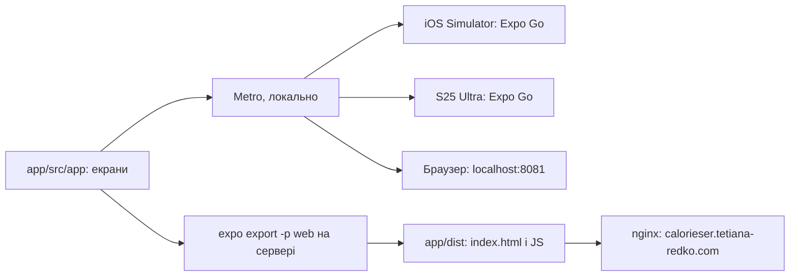
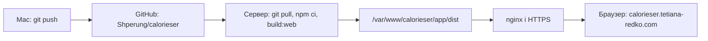

# План фронтенду: Expo + React Native Web

Покроковий план клієнта для розробника, який добре знає React і фронтенд, але менше — Expo і мобільну розробку. Мета плану — скелет: порожній додаток із трьома екранами запускається на iOS, Android і в браузері, а web-версія вже відкривається на справжньому сервері. Форми, авторизація й решта — потім.

Як цей файл пов'язаний з рештою:

- чотири кроки тут — це крок 7 «Плану» в `AGENTS.md`;
- контракт клієнта (файли, auth, AI) — `.cursor/rules/app.mdc`;
- сервер — `server/PLAN.md`. Від нього цей план не залежить: екрани поки не ходять в API.

## Словник

- **Expo** — набір інструментів поверх React Native: створює проєкт, запускає його на телефоні, збирає web і застосунки для сторів.
- **React Native** — React, у якому замість `div` і `span` — `View` і `Text`, а на екран виводяться нативні компоненти iOS та Android.
- **react-native-web** — бібліотека, яка в браузері перетворює `View` / `Text` на `div` / `span`. Завдяки їй web збирається з того самого коду.
- **Metro** — бандлер Expo, як Vite чи webpack: збирає JavaScript і під час розробки віддає його телефону чи браузеру.
- **Expo Go** — застосунок зі стору, в якому відкривається ваш проєкт без збирання власного застосунку. Нативні модулі в ньому фіксовані; якщо знадобиться інший, роблять **development build** — свій тестовий застосунок.
- **Expo Router** — навігація на файлах, як у Next.js: файл у `src/app/` — це екран і водночас URL у браузері.
- **Layout (`_layout.tsx`)** — файл, який описує навігатор для екранів своєї папки.
- **Stack** — навігатор «стос екранів»: новий екран кладеться зверху, «Назад» знімає його.
- **SPA** — односторінковий застосунок: сервер на будь-яку адресу віддає один `index.html`, а потрібний екран вибирає JavaScript.
- **nginx** — вебсервер на Hetzner, який віддає файли сайтів і передає запити Node-процесам.
- **DNS-запис A** — правило «ім'я → IP-адреса», завдяки якому `calorieser.tetiana-redko.com` веде на наш сервер.
- **certbot** — програма, яка отримує безкоштовний сертифікат Let's Encrypt для HTTPS і сама його продовжує.

## Папки верхнього рівня

Окремої папки `web/` немає: react-native-web перетворює `View` / `Text` на `div` / `span`, і Expo збирає web з того самого коду, що й iOS та Android. Якщо колись знадобиться інша поведінка в браузері, поруч із компонентом кладеться файл `*.web.tsx`, і Metro сам візьме його для web.

```
calorieser/
  app/          Expo: iOS, Android і web з одного коду
  server/       API: Hono + Postgres (server/PLAN.md)
  shared/       спільні zod-схеми й типи
  docs/         PRD, дослідження, беклог, журнал
  package.json  workspaces: app, server, shared
```

Всередині `app/`:

```
app/
  PLAN.md          цей файл
  package.json     main: expo-router/entry, скрипти
  app.json         назва, scheme, web.output
  tsconfig.json
  assets/          іконка, splash, favicon
  src/app/         екрани Expo Router: файл = маршрут
    _layout.tsx    Stack-навігатор
    index.tsx      Головна (/)
    sign-in.tsx    Вхід (/sign-in)
    sign-up.tsx    Реєстрація (/sign-up)
  src/components/  пізніше
  src/lib/         пізніше (api.ts, auth-client.ts)
  dist/            web-збірка, не в git
```

`app/` — це пакет у monorepo, а `src/app/` — папка маршрутів: так прийнято в Expo Router. `src/components/` і `src/lib/` створимо, коли в них з'явиться перший файл.



## Рішення і чому саме так

- **Expo SDK 58.** Він вийшов 15.10.2026, а Expo Go у Google Play і App Store з 19–22.10 відкриває лише SDK 58. Тож новий проєкт на SDK 57 у Expo Go на S25 Ultra просто не відкрився б. SDK 58 потребує Node 22.13+, 24.3+ або 26.
- **Шаблон `blank-typescript` + Expo Router вручну**, як у numismat. Це мінімум, і кожен файл зрозумілий. Шаблон `default` приносить демо-екрани, які довелося б видаляти, і `web.output: "server"`, якому потрібен Node-сервер.
- **Expo Router зі `Stack`.** Навігація на файлах: файл у `src/app/` — це і екран, і URL у браузері.
- **Web у тому самому додатку**: `react-native-web` + `react-dom` і `web.output: "single"` — односторінковий застосунок з одним `index.html`. SEO нам не потрібне, тож `static` (окремий HTML на кожен маршрут) і `server` (HTML на сервері для кожного запиту) лише додали б складності.
- **Expo Go для запуску.** Нативних модулів поза Expo Go поки немає, тож development build не потрібен.
- **Деплой як у numismat**: `git clone` на сервері, `npm ci` і збірка там, nginx + `certbot certonly` + 443-блок вручну. pm2 не потрібен: результат збірки — статичні файли.

## Перед стартом

- Node.js 26: `nvm use` у корені (версія в `.nvmrc`), `node -v` показує `v26.x`.
- Xcode з iOS Simulator — як для numismat.
- Expo Go на S25 Ultra з Google Play, оновлений до версії для SDK 58.
- Команди виконуємо з кореня репозиторію, якщо не сказано інше. `-w app` означає «виконати в пакеті `app`».

## Крок 1. Бойлерплейт

Мета: у `app/` лежить мінімальний Expo-проєкт з Expo Router і web, а `npx expo-doctor` не має зауважень.

### 1.1 Корінь monorepo

Що робимо: у кореневому `package.json` у `workspaces` додаємо `"app"`. Якщо кореневого `package.json` ще немає, бо сервер ще не почали, створюємо його, як у кроці 1.1 `server/PLAN.md`. У `workspaces` — лише папки, які вже існують; після обох планів:

```json
{
  "name": "calorieser",
  "private": true,
  "workspaces": ["app", "server", "shared"]
}
```

Навіщо: Expo сам помічає monorepo за полем `workspaces` і налаштовує Metro, тож окремий `metro.config.js` не потрібен. Один `npm install` у корені ставить залежності всіх пакетів в одну `node_modules`.

### 1.2 Створення проєкту

```bash
mv app/PLAN.md /tmp/calorieser-app-plan.md
npx create-expo-app@latest app --template blank-typescript@sdk-58 --no-install
mv /tmp/calorieser-app-plan.md app/PLAN.md
```

Навіщо:

- `create-expo-app` відмовляється створювати проєкт у непорожній папці, а в `app/` уже лежить цей файл, тому його на хвилину виносимо.
- `blank-typescript@sdk-58` — найменший шаблон з TypeScript, саме для SDK 58. Без `@sdk-58` у перехідний період можна отримати SDK 57.
- `--no-install`: залежності поставимо з кореня, щоб у пакета не з'явилися власні `node_modules` і `package-lock.json`.

### 1.3 Прибрати зайве

Що робимо:

- видалити `app/App.tsx` і `app/index.ts`: вхідною точкою тепер буде Expo Router;
- видалити `app/LICENSE`, а також `app/package-lock.json` і `app/node_modules`, якщо вони все ж з'явилися;
- видалити `app/AGENTS.md` і `app/CLAUDE.md`. Правила Expo з них уже є в `.cursor/rules/app.mdc` (розділ «Правила Expo»); якщо в новій версії шаблону з'явилося щось нове, дописати туди;
- перенести налаштування Claude Code в корінь: `mkdir -p .claude && mv app/.claude/settings.json .claude/ && rmdir app/.claude`.

Навіщо: правила проєкту живуть в одному місці — `AGENTS.md` у корені й `.cursor/rules/`. Cursor підхоплює кожен `AGENTS.md`, тож другий у `app/` дублював би перший і з часом почав би йому суперечити. `.claude/settings.json` вмикає офіційний плагін Expo для Claude Code, а Claude Code читає налаштування з папки, звідки його запускають, тобто з кореня.

### 1.4 Встановлення

```bash
npm install
cd app
npx expo install expo-router react-native-safe-area-context react-native-screens expo-linking expo-constants expo-status-bar react-native-web react-dom
cd ..
```

Навіщо:

- `npm install` у корені ставить залежності шаблону (`expo`, `react`, `react-native`) у спільну `node_modules`.
- `npx expo install` замість `npm install` підбирає версії, сумісні саме з SDK 58. Перші шість пакетів — Expo Router і те, на що він спирається (безпечні зони екрана, нативні екрани, посилання, константи, статус-бар). Останні два — для web.

### 1.5 Конфігурація

`app/package.json` — вхідна точка і скрипти (решту полів шаблону лишаємо):

```json
{
  "main": "expo-router/entry",
  "scripts": {
    "start": "REACT_NATIVE_PACKAGER_HOSTNAME=127.0.0.1 expo start",
    "start:tunnel": "expo start --tunnel",
    "ios": "REACT_NATIVE_PACKAGER_HOSTNAME=127.0.0.1 expo start --ios",
    "android": "expo start --android",
    "web": "expo start --web",
    "build:web": "expo export -p web"
  }
}
```

`app/app.json` — поля, які змінюємо або додаємо (решту з шаблону не чіпаємо):

```json
{
  "expo": {
    "name": "Calorieser",
    "slug": "calorieser",
    "scheme": "calorieser",
    "web": { "favicon": "./assets/favicon.png", "output": "single" },
    "plugins": ["expo-router"],
    "experiments": { "typedRoutes": true }
  }
}
```

`app/tsconfig.json`:

```json
{
  "extends": "expo/tsconfig.base",
  "compilerOptions": {
    "strict": true,
    "paths": { "@/*": ["./src/*"] }
  },
  "include": ["**/*.ts", "**/*.tsx", ".expo/types/**/*.ts", "expo-env.d.ts"]
}
```

Навіщо:

- `"main": "expo-router/entry"` — додаток стартує з Expo Router, а той сам знаходить екрани в `src/app/`.
- `REACT_NATIVE_PACKAGER_HOSTNAME=127.0.0.1` — як у numismat: на робочому Mac корпоративний клієнт блокує LAN-адресу, і симулятор підключається до Metro лише через `127.0.0.1`. Телефон ходить до Metro через інтернет-тунель — для цього `start:tunnel`.
- `build:web` збирає web-версію в `app/dist/`.
- `name` і `slug` шаблон бере з назви папки (`app`), тож задаємо свої: `name` бачить користувач, `slug` — службова назва проєкту в Expo.
- `scheme` — адреса для deep links (`calorieser://...`), без неї Expo Router не працює.
- `"output": "single"` — web як односторінковий застосунок з одним `index.html` (див. «Рішення»).
- `typedRoutes` — TypeScript перевіряє адреси в `<Link href>`: друкарська помилка в `/sign-in` підсвітиться ще в редакторі.
- `@/*` — короткі імпорти `@/components/...` замість `../../components/...`.

### 1.6 Перевірка кроку 1

```bash
cd app && npx expo-doctor
```

Перевірка має пройти без помилок. Якщо вона скаже про несумісні версії — `npx expo install --fix`. Екранів ще немає, тому запуск — у кроці 3.

## Крок 2. Навігація і порожні екрани

Мета: три екрани і переходи між ними. На екранах входу й реєстрації поки лише текст.

Як це працює: Expo Router будує навігацію з файлів у `src/app/`: `index.tsx` → `/`, `sign-in.tsx` → `/sign-in`, `sign-up.tsx` → `/sign-up`. `_layout.tsx` у тій самій папці описує, як ці екрани показувати; у нас це `Stack`.

### 2.1 Layout

`src/app/_layout.tsx`:

```tsx
import { Stack } from 'expo-router'

export default function RootLayout() {
  return (
    <Stack screenOptions={{ headerBackTitle: 'Назад' }}>
      <Stack.Screen name="index" options={{ title: 'Calorieser' }} />
      <Stack.Screen name="sign-in" options={{ title: 'Вхід' }} />
      <Stack.Screen name="sign-up" options={{ title: 'Реєстрація' }} />
    </Stack>
  )
}
```

Навіщо: `Stack` дає шапку із заголовком і кнопкою «Назад» на телефоні; у браузері «Назад» — це історія браузера. `Stack.Screen` задає заголовок кожного екрана, а `name` — це назва файлу без `.tsx`.

### 2.2 Головна

`src/app/index.tsx`:

```tsx
import { Link } from 'expo-router'
import { StyleSheet, Text, View } from 'react-native'

export default function Home() {
  return (
    <View style={styles.screen}>
      <Text style={styles.title}>Головна</Text>
      <Link href="/sign-in">Увійти</Link>
      <Link href="/sign-up">Зареєструватися</Link>
    </View>
  )
}

const styles = StyleSheet.create({
  screen: { flex: 1, alignItems: 'center', justifyContent: 'center', gap: 16 },
  title: { fontSize: 24, fontWeight: '600' },
})
```

Навіщо:

- `Link` з `expo-router` у браузері стає звичайним `<a href="/sign-in">`, тож його можна відкрити і в новій вкладці, а на телефоні він відкриває екран у `Stack`.
- `StyleSheet` — стилі React Native: майже CSS, але в camelCase і без каскаду. `flex: 1` розтягує екран на всю висоту.

### 2.3 Вхід і реєстрація

`src/app/sign-in.tsx`:

```tsx
import { Link } from 'expo-router'
import { StyleSheet, Text, View } from 'react-native'

export default function SignIn() {
  return (
    <View style={styles.screen}>
      <Text>Тут буде форма входу</Text>
      <Link href="/sign-up">Немає акаунта? Зареєструватися</Link>
    </View>
  )
}

const styles = StyleSheet.create({
  screen: { flex: 1, alignItems: 'center', justifyContent: 'center', gap: 16 },
})
```

`src/app/sign-up.tsx` — те саме з текстом «Тут буде форма реєстрації» і посиланням «Вже є акаунт? Увійти» на `/sign-in`.

Навіщо: поки це заглушки. Форми з'являться на кроці 8 разом з авторизацією, тоді ж однакові стилі винесемо в спільну тему.

### 2.4 Чого поки немає

- Захисту за входом. `Stack.Protected` сховає Головну від користувача без входу на кроці 8, коли з'являться токени.
- Табів. `(tabs)/` з'являться разом з екранами профілю і страви. Тоді `index.tsx` переїде в `(tabs)/index.tsx`, а URL `/` не зміниться: папки в дужках в адресу не потрапляють.

## Крок 3. Запуск на трьох платформах

Мета: ті самі три екрани відкриваються в iOS Simulator, на S25 Ultra і в браузері.

### 3.1 iOS Simulator

```bash
npm run ios -w app
```

Що відбувається: Metro збирає JavaScript, Expo CLI відкриває симулятор і, якщо треба, ставить у нього Expo Go для SDK 58. Перша збірка триває до хвилини.

### 3.2 S25 Ultra

```bash
npm run start:tunnel -w app
```

В Expo Go — «Scan QR code» і QR-код з термінала. Перший запуск тунелю попросить поставити `@expo/ngrok` — погоджуємося.

Якщо тунель обривається (`session closed`), як бувало в numismat: спершу `npm run start -w app`, зупинити, потім знову `start:tunnel`, або просто повторити спробу. Помилка «Project is incompatible with this version of Expo Go» означає, що Expo Go і проєкт на різних SDK: оновіть Expo Go з Google Play.

### 3.3 Браузер

```bash
npm run web -w app
```

Відкриється `http://localhost:8081`. Перевірте: перехід за посиланнями змінює URL; кнопки браузера «Назад» і «Вперед» працюють; адреса `http://localhost:8081/sign-in`, введена вручну, відкриває Вхід.

### 3.4 Готово, коли

- на всіх трьох платформах відкривається Головна з двома посиланнями;
- «Увійти» і «Зареєструватися» відкривають свої екрани, а посилання між ними працюють;
- «Назад» повертає на попередній екран.

Якщо після змін у конфігурації щось поводиться дивно — перезапустіть із чистим кешем: `npx expo start --clear` у папці `app/`.

## Крок 4. Web на сервері

Мета: `https://calorieser.tetiana-redko.com` відкриває ту саму Головну, що й локально.

Як це працює: `expo export -p web` складає web-версію в папку `dist/` — `index.html`, JavaScript і картинки. Node-процес для неї не потрібен, досить, щоб nginx віддавав ці файли. Як у numismat, код клонуємо на сервер і збираємо там. Відмінність одна: замість `pm2 restart` nginx одразу бачить нові файли.



### 4.1 Збірка локально

```bash
npm run build:web -w app
cd app && npx expo serve
```

Навіщо: `expo serve` відкриває на `http://localhost:8081` саме production-збірку з `dist/`, тобто так, як вона працюватиме на сервері. Помилки збірки краще знайти тут, а не на сервері.

### 4.2 DNS

У goodnet.ua додаємо запис `A`: ім'я `calorieser`, значення `116.203.220.233` — так само, як `inua` і `next`. Перевірка (запис може поширюватися до години):

```bash
dig +short calorieser.tetiana-redko.com   # 116.203.220.233
```

### 4.3 Код на сервері

Локально — `git push`. На сервері:

```bash
ssh root@116.203.220.233
node -v                     # не нижче 24.3 — вимога SDK 58
cd /var/www
git clone https://github.com/Shperung/calorieser.git
cd calorieser
npm ci
npm run build:web -w app    # результат — /var/www/calorieser/app/dist
```

Навіщо:

- `npm ci` ставить точно ті версії, що записані в `package-lock.json`, — як і для numismat.
- Якщо репозиторій приватний, клонуємо так само, як numismat (ключ доступу або токен GitHub).
- Якщо збірка обривається словом `Killed`, серверу (2 ГБ RAM) забракло пам'яті. Перевірте `free -h` і, якщо swap немає, додайте 2 ГБ:

```bash
fallocate -l 2G /swapfile && chmod 600 /swapfile && mkswap /swapfile && swapon /swapfile
echo '/swapfile none swap sw 0 0' >> /etc/fstab
```

### 4.4 nginx і HTTPS

Пастки цього сервера (з `numismat-server/AGENTS.md`):

- у `sites-enabled/default` є 443-блок для `*.tetiana-redko.com` з сертифікатом лише основного домену, тож новому піддомену потрібен власний 443-блок, інакше браузер покаже помилку сертифіката;
- `certbot --nginx -d …` через цей wildcard записує сертифікат у `default` і ламає основний сайт, тому лише `certbot certonly --nginx`, а 443-блок пишемо вручну;
- перед змінами робимо бекап, а файли `*.save` у `sites-enabled/` не лишаємо: nginx їх теж завантажує.

Спершу бекап і файл лише з портом 80 — він потрібен certbot для перевірки домену:

```bash
cp -r /etc/nginx /root/nginx.bak.$(date +%F)
nano /etc/nginx/sites-available/calorieser.tetiana-redko.com
```

```nginx
server {
    listen 80;
    server_name calorieser.tetiana-redko.com;
    root /var/www/calorieser/app/dist;
}
```

```bash
ln -s /etc/nginx/sites-available/calorieser.tetiana-redko.com /etc/nginx/sites-enabled/
nginx -t && systemctl reload nginx
certbot certonly --nginx -d calorieser.tetiana-redko.com
```

Коли сертифікат отримано, замінюємо вміст того самого файлу. Рядки `ssl_*` і `include` скопіюйте з `sites-available/inua.tetiana-redko.com`, замінивши домен:

```nginx
server {
    listen 80;
    server_name calorieser.tetiana-redko.com;
    return 301 https://$host$request_uri;
}

server {
    listen 443 ssl;
    server_name calorieser.tetiana-redko.com;

    ssl_certificate /etc/letsencrypt/live/calorieser.tetiana-redko.com/fullchain.pem;
    ssl_certificate_key /etc/letsencrypt/live/calorieser.tetiana-redko.com/privkey.pem;
    include /etc/letsencrypt/options-ssl-nginx.conf;
    ssl_dhparam /etc/letsencrypt/ssl-dhparams.pem;

    root /var/www/calorieser/app/dist;
    index index.html;

    location /_expo/static/ {
        add_header Cache-Control "public, max-age=31536000, immutable";
    }

    location / {
        try_files $uri $uri/ /index.html;
        add_header Cache-Control "no-cache";
    }
}
```

```bash
nginx -t && systemctl reload nginx
certbot renew --dry-run
```

Навіщо:

- `root` — папка з файлами сайту, тобто результат збірки.
- `try_files $uri $uri/ /index.html`: якщо файла за адресою немає (як для `/sign-in`), nginx віддає `index.html`, а екран вибирає Expo Router. Без цього оновлення сторінки на `/sign-in` дає 404.
- У `/_expo/static/` лежить JavaScript з хешем у назві файлу: кожна нова збірка дає нові назви, тож браузер може кешувати ці файли на рік. `index.html` — з `no-cache`, щоб після деплою одразу підтягувалась нова версія.
- Порт 80 лише перенаправляє на HTTPS.
- `certbot renew --dry-run` перевіряє, що сертифікат зможе продовжитися сам.

### 4.5 Оновлення

```bash
cd /var/www/calorieser && git pull && npm ci && npm run build:web -w app
```

pm2 тут не потрібен. Процеси pm2 numismat і `tetiana-redko.com` (id 0) не чіпаємо.

### 4.6 Перевірка кроку 4

- `https://calorieser.tetiana-redko.com` відкриває Головну, і браузер показує захищене з'єднання.
- Перехід на «Увійти» і оновлення сторінки на `/sign-in` показують той самий екран, а не 404.
- `http://calorieser.tetiana-redko.com` перенаправляє на `https://`.
- Сайт відкривається в браузері S25 Ultra та iPhone.
- `https://tetiana-redko.com`, `inua` і `next` працюють, як і раніше.

### 4.7 Надалі: API на тому самому домені

Коли сервер буде готовий (крок 14 в `AGENTS.md`), у цей самий 443-блок додамо:

```nginx
location /api/ {
    proxy_pass http://127.0.0.1:3003;
}
```

API працюватиме під pm2 на порту 3003, бо 3000–3002 уже зайняті. Сайт і API будуть на одному домені, тож браузеру не потрібен CORS, а додаток на телефоні ходитиме на `https://calorieser.tetiana-redko.com/api/...`.

## Структура після чотирьох кроків

```
calorieser/
  package.json            workspaces: app, server, shared
  .claude/settings.json   плагін Expo для Claude Code
  app/
    PLAN.md               цей файл
    package.json
    app.json
    tsconfig.json
    assets/
    src/app/
      _layout.tsx         Stack
      index.tsx           Головна
      sign-in.tsx         Вхід (заглушка)
      sign-up.tsx         Реєстрація (заглушка)
    dist/                 web-збірка, не в git

на сервері:
  /var/www/calorieser                                   git clone репозиторію
  /etc/nginx/sites-available/calorieser.tetiana-redko.com
```

## Що далі

- Крок 8: форми входу й реєстрації, токени (`expo-secure-store` на телефоні, `localStorage` у web) і `Stack.Protected` — див. `.cursor/rules/app.mdc`, розділ Auth.
- Кроки 9–12: профіль, вага, страва, «Сьогодні». Тоді з'являться таби, `src/components/` і `src/lib/`.
- Крок 14: API за `/api` на тому самому домені.
